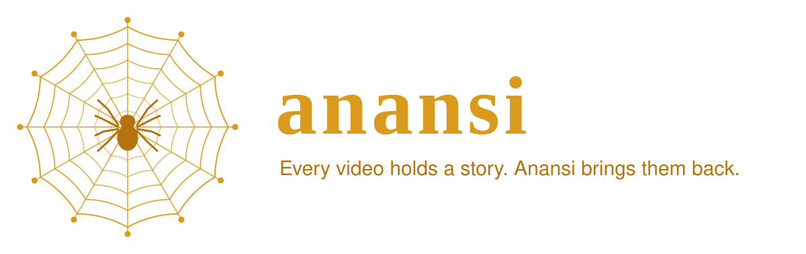

<p align="center">
  
</p>

<p align="center">
  <a href="https://github.com/mal0ware/anansi/actions/workflows/ci.yml"></a>
  
  
  
  <a href="LICENSE"></a>
</p>

<p align="center">
  <b>YouTube links in, transcripts, video and audio out.</b><br>
  A Claude Code plugin: share a video, and Claude goes and brings back everything that was said in it.
</p>

---

## The story of the stories

In the forests of the Akan people, in what is now Ghana, there was a time when the world had no stories.

Every tale that had ever been told belonged to **Nyame**, the Sky God. He kept them in a golden box beside his throne, and the people below lived without them: no history to remember, no wisdom passed from grandmother to child, nothing to tell around the fire at night.

**Kwaku Anansi**, the spider, was small, and he was not strong. But he was the cleverest creature alive. So he spun a thread all the way up to the sky and asked to buy the stories.

The Sky God laughed. Great kings had tried to buy them and failed. But he named his price: bring me **Onini** the python, **Osebo** the leopard, the **Mmoboro** hornets that sting like fire, and **Mmoatia**, the fairy no one has ever seen.

Anansi did not fight any of them. He was too small for that. He used his head:

- **The python.** Anansi told Onini that his wife thought the python was shorter than a palm branch. Insulted, Onini stretched out along the branch to prove her wrong, and Anansi bound him to it while he lay there being measured.
- **The leopard.** Anansi dug a deep pit across the leopard's path. Osebo fell in, and Anansi "rescued" him with a bent sapling that sprang him straight into a trap.
- **The hornets.** Anansi poured water over a banana leaf, over himself and over the nest, and shouted that the rain had come. He held out a dry gourd as shelter, and the whole swarm flew inside. He corked it.
- **The fairy.** Anansi carved a doll, covered it in sticky gum, and set a bowl of mashed yams in its lap. Mmoatia ate the yams, and when the doll didn't thank her, she slapped it. Her hand stuck. Then the other. Then her feet.

Anansi carried all four up his thread to the sky. And the Sky God, who had never seen anyone pay the price before, kept his word. *"From this day,"* he said, *"all stories belong to Anansi. Let them be called* **Anansesem**: *spider stories."*

Anansi brought them down to the people, and that is why we have stories today.

### The pot of wisdom

There is a second tale. Later, Anansi grew greedy and tried to gather all the world's wisdom into a single clay pot, to keep it for himself. He tied the pot to his belly and tried to climb a tall tree to hide it, but the pot kept getting in the way. His young son, Ntikuma, watching from below, called up: *"Father, why not tie it to your back?"*

Anansi realised that his collected wisdom wasn't all the wisdom there was. In frustration he threw the pot down. It shattered, and the wisdom scattered on the wind across the whole world. That is why no one person holds all of it, and why everyone holds a little.

### Across the ocean

The stories didn't stay in Ghana. They crossed the Atlantic with the Akan people who were taken in the slave trade, and survived in Jamaica, the Bahamas, Suriname, Curaçao and the American South as *Anancy*, *Aunt Nancy* and *Kompa Nanzi*. In those places the small trickster who outwits the powerful became a symbol of survival and quiet resistance. The spider who can't win by strength wins by cleverness, and the stories go on being told.

## How the legend maps to the code

anansi isn't just named after the spider. Every part of the tool is one of the stories.

| In the legend | In anansi |
|---|---|
| **The Sky God's box.** All the stories exist, but they are locked away where people can't use them. | Hours of talks, lectures and interviews sit inside video. You can watch it, but you can't search it, quote it, or hand it to Claude. |
| **The thread to the sky.** Anansi spins a line out and climbs to where the stories are kept. | `fetch` sends a thread out to every link you give it, four at a time, and brings back each video's full transcript. |
| **The python, measured.** Length is no defence against a patient trickster. | Long videos are broken into timestamped paragraphs at every chapter and every ~45 seconds, so a three-hour podcast becomes something you can navigate. |
| **The hornets in the gourd.** A swarm, caught in a single vessel. | Paste a whole chat log, a doc or a pile of links. anansi pulls out every YouTube ID, dedupes them, and gathers the lot into one merged document (or your clipboard). |
| **The leopard and the pit.** The strong guard is outwitted, not fought. | anansi doesn't scrape YouTube with brute force. It goes through [yt-dlp](https://github.com/yt-dlp/yt-dlp), which updates itself daily to keep up as YouTube changes. When YouTube does push back (rate limits, bot checks), anansi says so plainly instead of hammering it. |
| **The sticky doll.** Whatever touches it stays caught. | Every transcript is cached for 7 days. Ask about the same video again and it's back instantly, without another trip to the sky. |
| **Anansesem: spider stories.** The stories bear his name and his form. | Every result is an *anansi document*: a header (title, channel, date, duration, views, tags, chapters, description) and then the transcript, with `[m:ss]` timestamps so Claude can cite exactly where something was said. |
| **The broken pot.** Wisdom isn't meant to be hoarded in one place. | Plain text, MIT licensed, standard-library Python. Your transcripts aren't locked in an app: they're files on disk and text on your clipboard, ready for Claude or anything else. |
| **Across the ocean.** The stories survive the crossing and adapt. | Runs the same on macOS, Linux and Windows, and works with or without Claude. |

## Install

In Claude Code:

```text
/plugin marketplace add mal0ware/anansi
/plugin install anansi@anansi
```

Or from a terminal:

```bash
claude plugin marketplace add mal0ware/anansi
claude plugin install anansi@anansi
```

Restart Claude Code (or run `/reload-plugins`). That's it: no API keys, no `pip install`, no compiler. anansi downloads yt-dlp on first use.

**Recommended:** `brew install ffmpeg deno` (macOS). ffmpeg joins YouTube's separate video and audio streams into full-quality mp4s, and deno lets yt-dlp see every format. Transcripts and audio work without either.

## Use it

Just talk to Claude. The skill triggers whenever a YouTube link appears or you ask about a video:

- *"Summarize this: https://youtu.be/…"*
- *"What does she say about pricing across these three talks?"* (paste the links)
- *"Find the best videos on the Rust borrow checker and tell me which one to watch."*
- *"Pull the transcripts for every link in links.txt into ./notes."*
- *"Download the audio of this one."*

Or call it directly:

| Command | What it does |
|---|---|
| `/anansi <links>` | Fetch transcripts and summarize each video with timestamps |
| `/anansi search <query>` | Search YouTube |
| `/anansi download <links> [--audio]` | Save mp4 (or m4a) to ~/Downloads |
| `/anansi web` | Open the browser UI at http://localhost:8765 |

## An anansi document

```
================================================================================
TITLE:    Me at the zoo
CHANNEL:  jawed
DATE:     2005-04-24
DURATION: 0:19
URL:      https://www.youtube.com/watch?v=jNQXAC9IVRw
CHAPTERS: [0:00] Intro | [0:05] The cool thing | [0:17] End
...
================================================================================

[0:01] All right, so here we are, in front of the elephants

[0:05] the cool thing about these guys is that they have really... really really long trunks ...
```

## Without Claude

The engine is an ordinary command-line tool:

```bash
git clone https://github.com/mal0ware/anansi.git && cd anansi
./anansi fetch "https://youtu.be/jNQXAC9IVRw" --clipboard   # transcripts → clipboard
./anansi fetch --file links.txt --out transcripts/           # one .txt per video
./anansi search "rust borrow checker" -n 5
./anansi download "https://youtu.be/jNQXAC9IVRw" --audio
./anansi web                 # browser UI; `./anansi web install` runs it at login (macOS)
./anansi doctor              # check python / yt-dlp / ffmpeg
```

Quote URLs in zsh: the `?` in `watch?v=` is a wildcard there.

## How it's built

```
skills/anansi/SKILL.md         tells Claude when and how to use anansi
skills/anansi/scripts/
  anansi.py                    the CLI: fetch / search / download / web / doctor
  server.py                    engine: yt-dlp driver, transcript formatting, cache, web server
  index.html                   the browser UI
commands/anansi.md             the /anansi slash command
.claude-plugin/                plugin + marketplace manifests
```

- All YouTube access goes through yt-dlp, kept in `~/.cache/anansi/bin` and self-updating daily (a yt-dlp on your `PATH` wins).
- Transcripts prefer original English captions, and fall back to auto-captions.
- The web UI binds to 127.0.0.1 only and rejects foreign `Host`/`Origin` headers, so other websites can't drive it.

## Development

```bash
python3 -m unittest discover -s tests
claude plugin validate .
claude --plugin-dir .        # try local changes without reinstalling
```

anansi grew out of [ytmerge](https://github.com/mal0ware/ytmerge), a C++20 CLI for the same job.

## License

MIT. The stories in the videos belong to the people who told them: respect creators, YouTube's terms and copyright.

<sub>The Anansi tales are retold here from Akan oral tradition, which has many versions; details vary from teller to teller, as they should.</sub>
